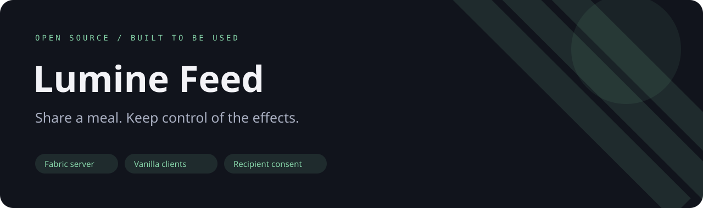
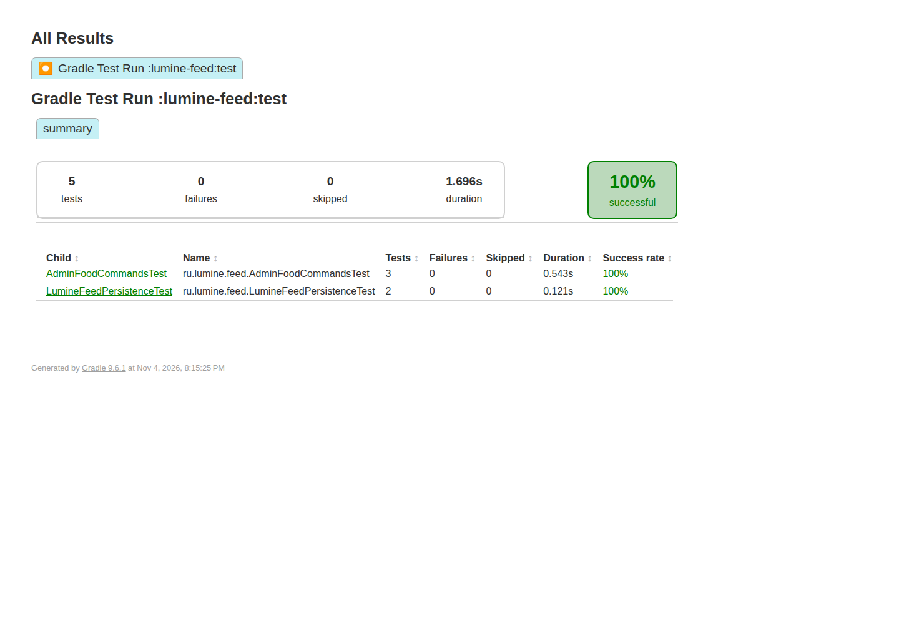

**English** · [Русский](README.ru.md)



# Lumine Feed

A small server-side Fabric mod that lets players feed one another, with recipient-controlled consent for food effects.

[](https://github.com/ari3lYT/lumine-feed/actions/workflows/ci.yml)
[](LICENSE)

[Quick start](#quick-start) · [Architecture](docs/architecture.md) · [Development](docs/development.md)


## See it



## Behavior

- Use edible food on another player to feed them; ordinary clients need no additional mod.
- Food with special effects is refused by default until the recipient opts in.
- `/feedtoggle effects on|off|toggle` and `/feedtoggle status` control recipient preferences.
- Operators can use `/feed [player]` and `/heal [player]`; console commands require owner permissions.
- Preferences are written atomically, and a persistence error is reported rather than claiming success.

## Quick start

**Minecraft 26.3 · Fabric Loader 0.19.5+ · Fabric API · Java 25+**

```bash
./gradlew build
```

Copy `lumine-feed/build/libs/lumine-feed-1.1.2.jar` into your server's `mods/` directory together with
the matching Fabric API. Restart the server. Players do not need a client mod.

Use food on a player. The recipient may opt into effect food with `/feedtoggle effects on`.
Ordinary food remains available without opting into effect food. D2Gate is optional: standalone
servers use vanilla OP checks; when D2Gate is installed, its player unlock check is also enforced.

## Configuration and development

[Configuration and commands](docs/configuration.md) · [Architecture](docs/architecture.md) · [Development](docs/development.md)

```bash
./gradlew :lumine-feed:test :lumine-feed:spotbugsMain
```

This public 26.3 candidate is intended for evaluation before production deployment. Automated checks
do not replace a two-player test of actual feeding, item remainders and effect consent on your server.

[Release verification and limits](docs/verification.md) · [Changelog](CHANGELOG.md)
