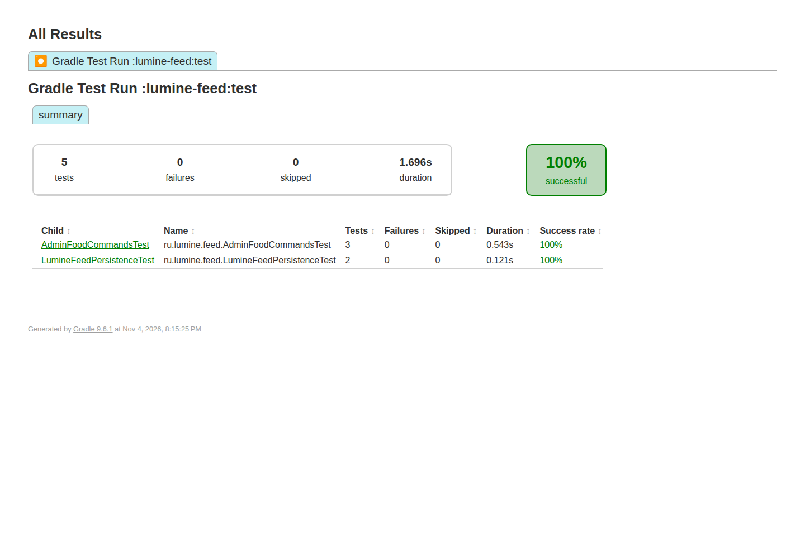

[English](README.md) · **Русский**


# Lumine Feed

Небольшой серверный Fabric-мод: игроки могут кормить друг друга, а получатель сам разрешает еду с эффектами.

[](https://github.com/ari3lYT/lumine-feed/actions/workflows/ci.yml)
[](LICENSE)

[Быстрый старт](#быстрый-старт) · [Архитектура](docs/architecture.ru.md) · [Разработка](docs/development.ru.md)

## Скриншот



## Поведение

- Используйте съедобный предмет на другом игроке, чтобы покормить его; дополнительный мод на клиенте не нужен.
- Еда со специальными эффектами по умолчанию запрещена, пока получатель сам её не разрешит.
- `/feedtoggle effects on|off|toggle` и `/feedtoggle status` управляют предпочтениями получателя.
- Операторы могут применять `/feed [player]` и `/heal [player]`; для консоли нужны права владельца.
- Предпочтения сохраняются атомарно; при ошибке записи пользователь получает сообщение об ошибке.

## Быстрый старт

**Minecraft 26.3 · Fabric Loader 0.19.5+ · Fabric API · Java 25+**

```bash
./gradlew build
```

Скопируйте `lumine-feed/build/libs/lumine-feed-1.1.2.jar` и подходящий Fabric API в каталог `mods/` сервера. Перезапустите сервер. Клиентский мод игрокам не требуется.

Используйте еду на игроке. Получатель может разрешить еду с эффектами командой `/feedtoggle effects on`. Обычная еда доступна без этого согласия. D2Gate необязателен: отдельная установка использует стандартную проверку OP; при установленном D2Gate дополнительно проверяется разблокировка игрока.

## Настройка и разработка

[Настройки и команды](docs/configuration.ru.md) · [Архитектура](docs/architecture.ru.md) · [Разработка](docs/development.ru.md)

```bash
./gradlew :lumine-feed:test :lumine-feed:spotbugsMain
```

Эта публичная сборка для 26.3 предназначена для оценки перед установкой на рабочий сервер. Автоматические проверки нужно дополнить тестом с двумя игроками: реальное кормление, возврат ёмкостей и согласие на эффекты.

[Проверки релиза и их границы](docs/verification.ru.md) · [История изменений](CHANGELOG.ru.md)
