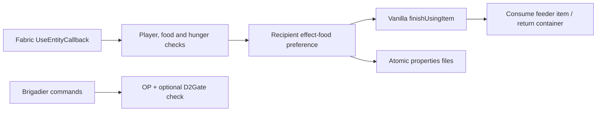

**English** · [Русский](architecture.ru.md)

# Architecture

`LumineFeed` owns interaction validation, effect detection, messages and recipient preferences.
`AdminFoodCommands` owns the administrative commands. It replaces same-named Brigadier command
roots deliberately, including startup re-registration; review conflicts with other `/feed` or `/heal` mods.

Effect food is opt-in per recipient UUID. Failure to read consent refuses effect food. Persistence writes
a temporary file and moves it into place, with a non-atomic-move fallback for unsupported filesystems.
Vanilla `finishUsingItem` preserves food-specific consumption behavior and item remainders.
