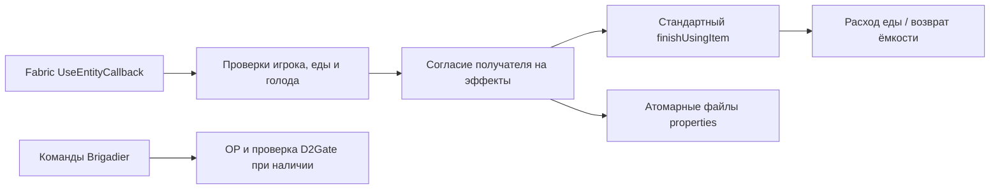

[English](architecture.md) · **Русский**

# Архитектура

`LumineFeed` отвечает за проверку взаимодействий, обнаружение эффектов, сообщения и предпочтения получателя. `AdminFoodCommands` содержит административные команды. Он намеренно заменяет одноимённые корневые команды Brigadier, в том числе при повторной регистрации во время запуска; проверьте конфликты с другими модами команд `/feed` и `/heal`.

Согласие на еду с эффектами хранится для UUID получателя. При ошибке чтения согласия такая еда отклоняется. Настройки сначала записываются во временный файл, затем перемещаются на место; на файловых системах без атомарного перемещения есть обычный резервный вариант. Стандартный `finishUsingItem` сохраняет особенности употребления пищи и возврат оставшихся предметов, например ёмкостей.
